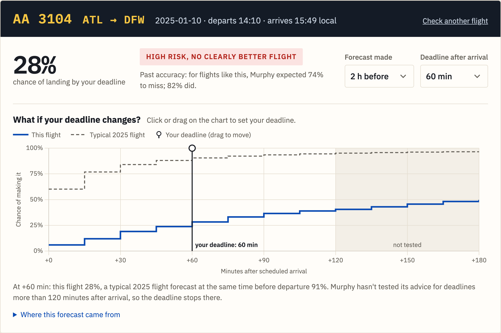
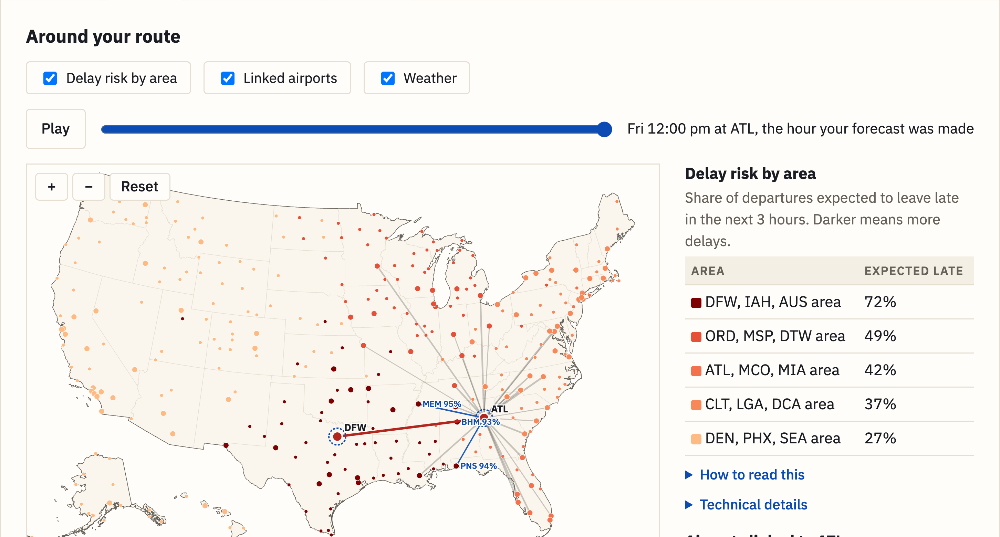
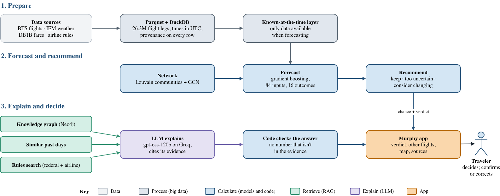

# Murphy

**Will my flight get me there in time, and should I switch?**

Murphy forecasts the chance that a specific flight gets you to your
destination by your own deadline. If the risk is high, it checks whether
another flight on the same route would do better. Every answer comes with its
evidence, its source and its uncertainty.

CS 5542 Big Data Analytics & Applications, Fall 2026 · Hallee Pham (solo project)

[Poster (PDF)](poster/murphy-poster.pdf) · [Poster on Google Drive](POSTER_DRIVE_LINK) ·
[Demo video](VIDEO_DRIVE_LINK) · [Results](results/RESULTS.md)



---

## Results at a glance

Tested on **January–August 2026**, held out until every model and rule was
frozen, and scored once. That's 1.44 million forecasts on 479,815 flights.

- **The forecast beats every simpler baseline.** Its multiclass Brier score is
  0.5659, against 0.6145 for airport climatology and 0.6024 for a
  schedule-only model.
- **Its risk levels hold.** Of the flights it put at "60% and up" to miss a
  60-minute deadline, 81.8% missed.
- **The advice helps.** It gives 1.44 net trips rescued per 1,000 trips,
  against 0.19 for a traveler's rule of thumb (switch if the inbound plane is already too late).
- **All 13 pre-set pass/fail tests pass.**

The full tables, baselines, ablation and limits are in
[results/RESULTS.md](results/RESULTS.md).

## What it does

| Feature | Method |
|---|---|
| Chance of making your deadline | Gradient-boosted model over 16 delay outcomes, using only what was known at forecast time |
| Keep or change | A fixed rule on the forecasts for your flight and every alternative on the route |
| "Why is this flight at risk?" | GraphRAG: Neo4j queries collect evidence, then an LLM explains it |
| Delay risk around your route | Airport communities (Louvain) and a graph neural network (GCN) |
| Similar past days | Nearest-neighbor retrieval over earlier days at the same airport |
| Your rights if it goes wrong | Embedding retrieval over federal rules and airline contracts, quoted as written |

The user stays in control. They can change the deadline and the forecast
time, compare alternatives, inspect the evidence, and mark an answer right or
wrong.



## Architecture

Each part has one job. The data system processes, the models calculate,
retrieval finds evidence, and the LLM only explains. **No number comes from
the LLM.**



## Quick start

Requires Python 3.12. The app's data (a 343 MB download) comes from this
repository's release.

```bash
git clone https://github.com/halleepham/murphy.git
cd murphy
python3.12 -m venv .venv
.venv/bin/pip install -r requirements.txt
.venv/bin/python scripts/download_data.py
PYTHONPATH=. .venv/bin/uvicorn murphy.app.main:app --port 8765
```

Then open <http://localhost:8765>.

Two tabs need more setup. **Ask** needs a free Neo4j Aura instance and a Groq
key in `.env`. **Rules** needs the airline contracts downloaded locally,
because they can't be redistributed. See [docs/REPRODUCE.md](docs/REPRODUCE.md).

Run the tests with `.venv/bin/python -m pytest -q`.

## Data

| Source | What | License |
|---|---|---|
| [BTS Marketing Carrier On-Time Performance](https://www.transtats.bts.gov/DL_SelectFields.aspx?gnoyr_VQ=FGK&QO_fu146_anzr=b0-gvzr) | US flights marketed by 7 airline networks, Jan 2023 – Aug 2026 | Public domain |
| Iowa Environmental Mesonet: [ASOS](https://mesonet.agron.iastate.edu/request/download.phtml), [TAF](https://mesonet.agron.iastate.edu/request/taf.php) | Weather observations and forecasts (TAF) as issued, 30 busiest airports | Free public archive |
| [BTS DB1B Market](https://www.transtats.bts.gov/DL_SelectFields.aspx?gnoyr_VQ=FHK&QO_fu146_anzr=b0-gvzr) | Fares, Q2 2025 | Public domain |
| [OurAirports](https://ourairports.com/data/) | Airport codes and locations | Public domain |
| eCFR: [14 CFR 250](https://www.ecfr.gov/current/title-14/part-250), [259](https://www.ecfr.gov/current/title-14/part-259), [260](https://www.ecfr.gov/current/title-14/part-260) | Passenger rights rules | Public domain |
| [Delta](https://www.delta.com/us/en/legal/contract-of-carriage-dgr) and [Southwest](https://www.southwest.com/swa-resources/pdfs/corporate-commitments/contract-of-carriage.pdf) contracts of carriage | Airline policies | Not redistributed: built locally |

Sampling, splits and what the release contains: [docs/DATA.md](docs/DATA.md).

## Reproducing the results

- **Run the app:** see the quick start above (minutes).
- **Rebuild everything** from the public sources: fetch, build inputs, train,
  replay, evaluate. It takes hours and about 14 GB. The steps, in order:
  [docs/REPRODUCE.md](docs/REPRODUCE.md).

## Repository layout

```
murphy/          the package: data layer, forecast, graph, retrieval, app
  app/           FastAPI server and the web pages
scripts/         download, build, train and evaluate, run as steps
tests/           pytest, including failure cases
results/         result files and RESULTS.md
docs/            data, reproduction steps, screenshots
poster/          the research poster
```
